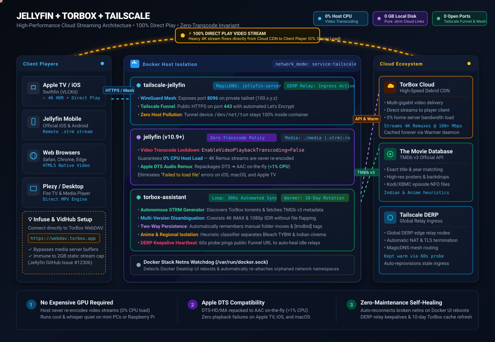

<div align="center">

# 🎬 Jellyfin + TorBox + Tailscale

### High-Performance Cloud Streaming Media Server • 100% Direct Play • Zero-Transcode Invariant

[](https://www.docker.com/)
[](https://jellyfin.org/)
[](https://tailscale.com/)
[](https://torbox.app/)
[](https://www.python.org/)
[](LICENSE)

<br/>

<p align="center">
  <b>A completely self-contained, isolated media streaming stack designed to turn TorBox cloud downloads into an instant, high-speed 4K/HDR Jellyfin library with zero storage overhead, zero video transcoding strain, and zero open router ports.</b>
</p>

<p align="center">
  <a href="#why-this-architecture"><b>Why This Architecture?</b></a> •
  <a href="#animated-architecture-overview"><b>Architecture Diagram</b></a> •
  <a href="#key-features"><b>Key Features</b></a> •
  <a href="#quick-start-guide"><b>Quick Start</b></a> •
  <a href="#client-playback-compatibility"><b>Client Setup</b></a> •
  <a href="#architectural-invariants--rules"><b>Invariants &amp; Rules</b></a> •
  <a href="#troubleshooting--maintenance"><b>Maintenance</b></a>
</p>

</div>

---

## 💡 Why This Architecture?

Traditional self-hosted media servers require massive multi-terabyte storage arrays, power-hungry GPUs for real-time 4K transcoding, complex dynamic DNS configs, and vulnerable open router ports. 

**This stack re-engineers media streaming from first principles:**

| Traditional Media Server | Jellyfin + TorBox + Tailscale |
| :--- | :--- |
| ❌ **Multi-Terabyte Storage**: Thousands spent on HDDs, NAS bays, and RAID arrays. | ⚡️ **0 GB Local Disk**: Media files are lightweight `.strm` links pointing directly to the TorBox debrid cloud. |
| ❌ **Heavy CPU/GPU Transcoding**: Host fans scream re-encoding 4K Remuxes to 1080p. | ⚡️ **0% Video CPU Strain**: Strictly locked to Direct Stream. Video streams direct from TorBox CDN to client. |
| ❌ **Apple DTS Playback Failures**: Disabling transcoding breaks DTS audio playback on Apple devices. | ⚡️ **Smart DTS Remuxing**: DTS-HD/MA is repacked into AAC on-the-fly (`<1%` CPU) while keeping 4K video 100% direct. |
| ❌ **Open Router Ports & DDNS**: Requires exposing ports `80`/`443`/`8096` to the public internet. | ⚡️ **Zero Open Ports**: Tailscale WireGuard mesh + Tailscale Funnel with automatic Let's Encrypt certificates. |
| ❌ **Manual Metadata & Sorting**: Manually renaming files and fixing poster matches. | ⚡️ **Autonomous Assistant**: Continuous TMDb matching, multi-version handling, NFO downloads, and cache warming. |

---

## 📐 Animated Architecture Overview

<p align="center">
  
</p>

### 🔄 How The Data Flows

```
[ Client App ] ───(1. Browse / Playback Request)───► [ Tailscale Mesh / Funnel ]
                                                              │
                                                              ▼
                                                   [ Jellyfin Server:8096 ]
                                                              │
               ◄──(2. Returns Cloud .strm Redirect)───────────┘
               │
               ▼
[ Client Video Player Engine ] ───(3. 100% Direct Play 4K Stream)───► [ TorBox CDN ]
(Swiftfin / VLCKit / HTML5)                                          (0% Host Server Load!)
```

#### 1. Ingestion & Metadata Synchronization (`torbox-assistant`)
* Every 5 minutes (`SYNC_INTERVAL_SECONDS=300`), the `torbox-assistant` daemon queries the **TorBox API** for all completed torrents and web downloads.
* Queries **The Movie Database (TMDb v3 API)** to match exact titles, years, and categories (Movies vs TV vs Anime).
* Downloads high-resolution official posters and generates XBMC/Kodi-compatible `.nfo` files with `<uniqueid type="tmdb" default="true">` tags to guarantee 100% accurate metadata in Jellyfin without scraping delay.

#### 2. Multi-Version Release Organization
* When multiple torrent releases exist for the exact same movie (e.g. `2160p IMAX WEB-DL HDR` and `2160p Remux DV`), files are written using Jellyfin's multi-version schema (`Title (Year) [tmdbid-XXXXX] - [Quality].strm`).
* Jellyfin automatically merges them under a single movie card with an interactive version selection dropdown.
* Eliminates file flapping and library scanner thrashing.

#### 3. Client Playback & Stream Delivery (The 100% Direct Play Invariant)
* When a user taps Play on an Apple TV, iPhone, or web browser, the client requests the video stream via Jellyfin.
* Jellyfin reads the `.strm` link and returns a direct stream redirection pointing to the TorBox CDN.
* The client's video engine (VLCKit on Swiftfin, MPV on Plezy, AVPlayer on iOS) initiates a direct HTTP/HTTPS connection to TorBox's high-speed CDN.
* **The result:** The multi-gigabyte 4K/HDR video stream flows **directly between TorBox and the client**, completely bypassing your home server's CPU and bandwidth!

#### 4. Autonomous Maintenance & Self-Healing
* **Docker UI Netns Watchdog**: Monitors `/var/run/docker.sock`. If `tailscale-jellyfin` is restarted or toggled in Docker Desktop, the watchdog immediately reconnects the bridge network and re-attaches `jellyfin` and `torbox-assistant` so they never get trapped in an orphaned network namespace.
* **DERP Keepalive Heartbeat**: Pings the public Tailscale Funnel endpoint every 60 seconds to prevent edge relay NAT dropouts. Automatically triggers auto-repair if edge sessions desync.
* **TorBox Cache Warmer**: Cycles continuously through your entire TorBox debrid library on a 10-day pacing loop, maintaining cached torrent status with zero API rate-limit violations.

---

## 🚀 Key Features

### 1. The Zero-CPU Transcoding Lockdown
<details>
<summary><b>Why video transcoding is disabled while audio remuxing is enabled (Click to expand)</b></summary>
<br/>

Most Docker Jellyfin guides tell you to either pass an NVIDIA GPU or accept heavy 100% CPU usage. Because this stack streams directly from cloud debrid, **video transcoding is completely turned off**:

- **`EnableVideoPlaybackTranscoding=False`**: Jellyfin will never attempt to decode and re-encode high-bitrate HEVC/H.264 streams. A cheap Mac Mini, Intel NUC, or Raspberry Pi can easily serve multiple concurrent 4K streams with 0% CPU strain.
- **`EnableAudioPlaybackTranscoding=True` & `EnablePlaybackRemuxing=True`**:
  - *The Apple DTS Dilemma*: Apple devices (iOS, macOS, tvOS) do not contain native hardware decoders for DTS audio tracks (DTS-HD MA 7.1, DTS-ES 5.1). If you completely disable audio transcoding, Jellyfin declares the file unplayable (`SupportsDirectPlay: False`), resulting in client errors: `"Playback error, failed to load file, please check network"`.
  - *The Fix*: Keeping audio remuxing enabled allows Jellyfin to repackage DTS into standard AAC (`-codec:v copy -codec:a libfdk_aac`). The video remains 100% Direct Stream, audio is transcoded with $< 1\%$ CPU, and playback starts instantly.

</details>

### 2. Standalone Library Assistant (`torbox-assistant`)
<details>
<summary><b>Two-way folder persistence, anime isolation & Indian regional cinema heuristics</b></summary>
<br/>

The included `torbox-assistant` container operates fully autonomously:
- **Two-Way Persistence**: If you move a movie folder from `Uncategorized` to `Movies`, or rename a folder with a custom `[tmdbid-XXXXX]` tag on disk, the generator detects your modification during the next cycle and permanently saves it into `media_cache.db`. It will **never** overwrite your manual customizations.
- **Anime Isolation**: Strict anime release group heuristics separate movies into `Anime Movies` and TV shows into `Anime TV`.
- **Bleach: Thousand-Year Blood War Isolation**: Releases matching `TYBW` or `Sennen Kessen-hen` are isolated into their own modern series structure (`Anime TV/Bleach Thousand-Year Blood War (2022) [tmdbid-335660]`) with season 2 TMDb mappings, preventing them from contaminating the original 2004 Bleach library.
- **Indian Regional Cinema Heuristics**: Custom query sanitation and regional indicator parsing (Tamil, Telugu, Malayalam, Hindi, Kannada) ensure accurate TMDb matching and original posters for regional releases.
- **Extras & Sample Filtering**: Non-episode clips (`sample`, `trailer`, `ncop`, `nced`, `gag reel`, `featurettes`) are filtered out so they never overwrite Episode 1.

</details>

### 3. Containerized Tailscale Mesh & Funnel
<details>
<summary><b>Zero-config public HTTPS & private WireGuard mesh without open ports</b></summary>
<br/>

- **Host Network Isolation**: Tailscale runs inside Docker via `service:tailscale` with `--device /dev/net/tun`. The host operating system's routing tables and network adapters are completely untouched.
- **Tailscale Mesh**: Stream privately over WireGuard via `http://jellyfin-server:8096` or `http://100.x.y.z:8096` with zero bandwidth throttling and lowest latency.
- **Tailscale Funnel**: Serves public HTTPS on port 443 with automated Let's Encrypt SSL certificates. Friends and family can stream without installing Tailscale or having an account. See [TAILSCALE_FUNNEL.md](TAILSCALE_FUNNEL.md).

</details>

### 4. 1-Click Automated Setup Wizard (`setup_jellyfin.py`)
<details>
<summary><b>Automates the entire Jellyfin setup process via REST API</b></summary>
<br/>

Running `python3 setup_jellyfin.py` configures your Jellyfin server end-to-end:
1. Completes the first-run Jellyfin startup wizard.
2. Creates your admin account (with custom or auto-generated secure credentials).
3. Locks down the zero-transcode user policy.
4. Creates 4 pre-configured media libraries (`Films`, `TV Programmes`, `Films (Anime)`, `TV Programmes (Anime)`).
5. Disables trickplay and chapter image extraction for lightning-fast library scanning.
6. Generates your Jellyfin API token and saves it to `jellyfin_api_key.txt`.
7. Triggers the initial library refresh.

</details>

---

## ⚡️ Quick Start Guide

### Step 1: Clone the Repository
```bash
git clone https://github.com/Suwadith/Jellyfin-TorBox-Tailscale.git
cd Jellyfin-TorBox-Tailscale
```

### Step 2: Configure Environment Variables
Copy `.env.example` to `.env`:
```bash
cp .env.example .env
```

Edit `.env` and fill in your API credentials:
```ini
# TorBox API Bearer Token (from https://torbox.app/settings)
TORBOX_API_TOKEN=your_torbox_api_token_here

# TMDb API v3 Key (from https://www.themoviedb.org/settings/api)
TMDB_API_KEY=your_tmdb_api_key_here

# Optional: Tailscale pre-auth key (leave blank for interactive browser login)
TS_AUTHKEY=
```

### Step 3: Create Placeholder Key Files
Prevent Docker from creating directories for single-file mounts:
```bash
touch jellyfin_api_key.txt credentials.txt
```

### Step 4: Build & Launch Stack
```bash
docker compose up -d --build
```

### Step 5: Authenticate Tailscale
If you left `TS_AUTHKEY` blank, grab your one-click authorization URL from the container logs:
```bash
docker compose logs -f tailscale
```
*(Open the link in your browser to approve the `jellyfin-server` node in your Tailscale admin console).*

### Step 6: Run 1-Click Auto-Provisioning
```bash
python3 setup_jellyfin.py
```
> [!TIP]
> Your admin credentials will be displayed in the terminal and saved locally in `credentials.txt`. Your API key is stored in `jellyfin_api_key.txt`.

---

## 📱 Client Playback Compatibility

Because media items are `.strm` links pointing to TorBox's cloud CDN, different clients have specialized playback behaviors:

| Client Platform | Connection Method | Playback Engine | Performance & Compatibility |
| :--- | :--- | :--- | :--- |
| **Swiftfin (Apple TV / iOS)** | Connect to Jellyfin URL | Native **VLCKit** | **100% Direct Play**. Flawless 4K HDR10, Dolby Vision, and spatial audio playback. |
| **Jellyfin Mobile (iOS / Android)** | Connect to Jellyfin URL | Native / ExoPlayer | **100% Direct Play**. Automatically follows cloud `.strm` redirects. |
| **Web Browsers (Safari / Chrome)** | Open Web Dashboard | HTML5 Video | Direct play for all browser-supported codecs (H.264, VP9, AV1). |
| **Desktop / Fire TV (Plezy)** | Connect to Jellyfin URL | Native **MPV** | **100% Direct Play**. Direct DirectStream/DirectPlay without remuxing. |
| **Infuse &amp; VidHub** | Connect to TorBox WebDAV | Local Player | **Recommended**: Connect directly to `https://webdav.torbox.app`. Bypasses media server HTTP buffering limitations (Jellyfin Issue #12306). |

---

## ⚙️ Environment Variable Reference

| Variable | Required | Default | Purpose |
| :--- | :---: | :---: | :--- |
| `TORBOX_API_TOKEN` | **Yes** | — | TorBox API Bearer Token (Pro/Standard account). |
| `TMDB_API_KEY` | **Yes** | — | TMDb API Key (v3) for metadata matching and posters. |
| `TS_AUTHKEY` | No | — | Optional Tailscale pre-authentication key for headless deploy. |
| `SYNC_INTERVAL_SECONDS` | No | `300` | TorBox sync loop interval in seconds (default: 5 minutes). |
| `WARMER_CYCLE_DAYS` | No | `10` | TorBox cache warmer full-library rotation cycle in days. |
| `FUNNEL_URL` | No | — | Public Funnel URL for automated keepalive heartbeat (e.g. `https://jellyfin-server.<tailnet>.ts.net/System/Info/Public`). |
| `CF_UPDATE_URL` | No | — | Cloudflare Dynamic IP Worker ping URL to update dynamic ISP IP. |
| `CF_STREAM_URL` | No | — | Cloudflare Worker reverse proxy URL for TorBox streams (optional). |
| `JELLYFIN_ADMIN_USER` | No | `admin` | Admin username created by `setup_jellyfin.py`. |
| `JELLYFIN_ADMIN_PASSWORD` | No | *(Auto)* | Admin password. Generates a 16-character secure password if empty. |

---

## 🛠 Troubleshooting & Maintenance

### Checking Live Logs
```bash
# View Tailscale logs & Funnel connection status
docker compose logs -f tailscale

# View TorBox Assistant logs (STRM generator, warmer, watchdog)
docker compose logs -f torbox-assistant

# View Jellyfin server logs
docker compose logs -f jellyfin
```

### Inspecting Persistent Daemon Logs
All assistant daemons log to `./torbox_assistant/logs/`:
- **`generator.log`**: STRM generation, TMDb matching, and file deletions/moves.
- **`warmer.log`**: Cache warmer request pacing, progress timestamps, and responses.
- **`supervisor.log`**: Docker netns watchdog events and Funnel keepalive heartbeats.

### Forcing An Immediate Library Sync
To bypass the 5-minute timer and run a sync cycle on-demand:
```bash
docker exec torbox-assistant python3 /app/jellyfin_strm_generator.py
```

### Migrating Watch History from Plex
If you are moving from an existing Plex server, use the included migration utility to transfer watched timestamps and play counts:
```bash
python3 scripts/sync_plex_watch_history.py \
  --plex-db "~/Library/Application Support/Plex Media Server/Plug-in Support/Databases/com.plexapp.plugins.library.db" \
  --jellyfin-user "admin"
```

---

## 📜 Architectural Invariants & Rules

1. **The Transcoding Lockdown Invariant**: `EnableVideoPlaybackTranscoding` must always remain `False`. `EnableAudioPlaybackTranscoding` and `EnablePlaybackRemuxing` must always remain `True`.
2. **The Netns Watchdog Invariant**: Dependent containers (`jellyfin`, `torbox-assistant`) must run with `network_mode: service:tailscale` and rely on `supervisor.py` to auto-heal when Docker Desktop restarts the stack.
3. **The Duplicate Provider Invariant**: Jellyfin NFO files generated by `torbox-assistant` must strictly use `<uniqueid type="tmdb" default="true">` without redundant `<tmdbid>` tags to prevent SQLite unique constraint crashes in `BaseItemProviders`.
4. **Zero Uncategorized Invariant**: Every active TorBox torrent is matched against TMDb or sanitized to prevent orphan items from leaking into unmonitored sections.

---

## 📄 License

This project is licensed under the [MIT License](LICENSE).
